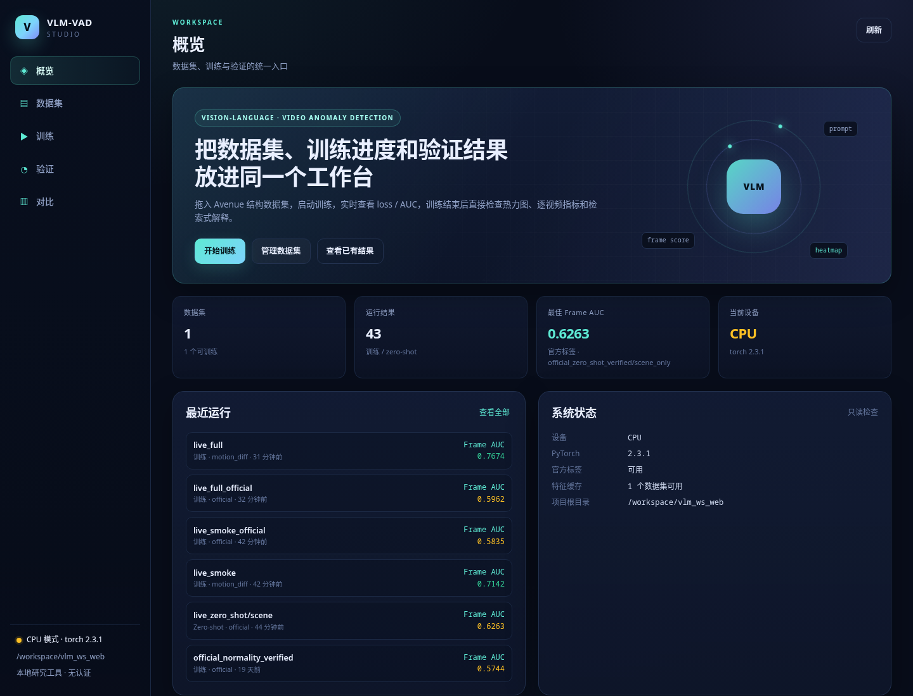
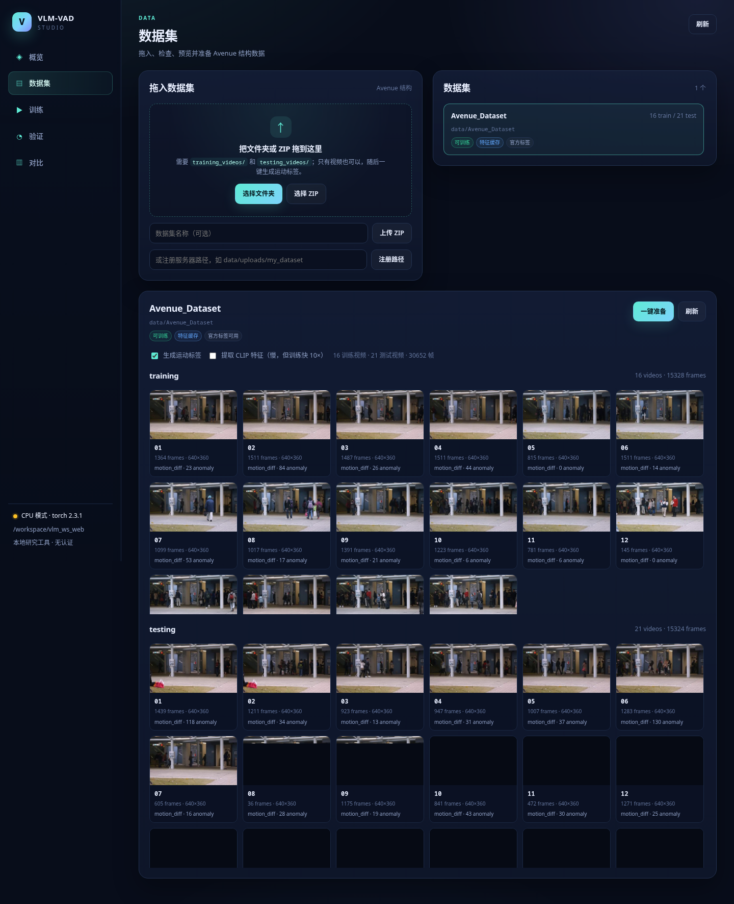
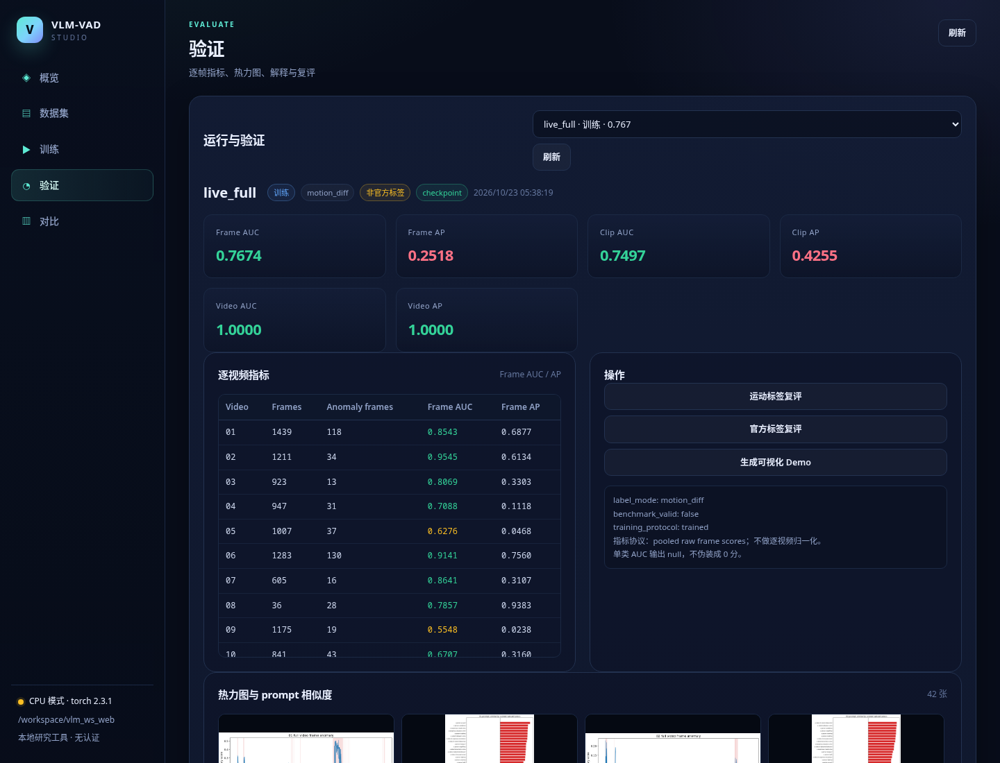
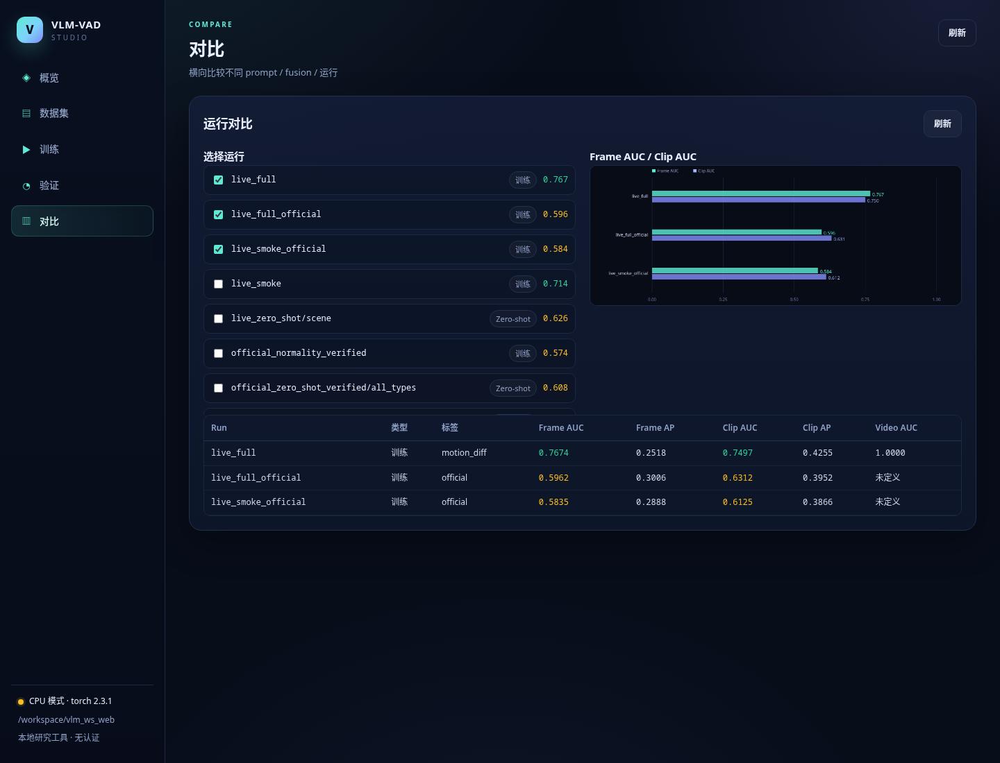

# VLM-VAD Studio（Web GUI）

Web UI 与训练代码已整合到同一仓库，使用同一套 CPU/CUDA 镜像、数据和缓存。
它是现有训练/评估代码之上的**模块化 Web 层**。

## 启动

在仓库根目录，选择 CPU 或 NVIDIA 后端，拉取预构建镜像后启动：

```bash
./scripts/dev.sh cpu pull
./scripts/dev.sh cpu web up -d
# 浏览器打开 http://127.0.0.1:8000

# NVIDIA 用户改用 gpu；需要宿主驱动和 NVIDIA Container Toolkit
./scripts/dev.sh gpu pull
./scripts/dev.sh gpu web up -d
```

停止：

```bash
./scripts/dev.sh cpu web down
```

`web` 在普通开发配置上叠加 `docker-compose.web.yml`，改变启动命令并增加 Web 端口，
继承镜像、UID/GID、工作目录、项目缓存卷和 GPU 配置。无需预建外部卷或挂载父目录。
Flask 已包含在镜像中。CPU 与 GPU 共用项目服务，切换后端前先执行当前模式的 `down`。
端口被占用时设置 `.env` 中的 `WEB_PORT`；默认仅监听宿主的 `127.0.0.1`。

```bash
./scripts/dev.sh cpu web logs -f
./scripts/dev.sh cpu web shell
```

Web 与命令行直接共享仓库内的 `data/`、`results/`、`checkpoints/`、`logs/`。
历史 `feat/web-studio` 工作树仍可保留，整合后的运行入口在当前仓库根目录。

## 界面

| 页面 | 能力 |
|---|---|
| 概览 | 数据集/运行数量、最佳 Frame AUC、设备、最近运行 |
| 数据集 | 拖入文件夹或 ZIP、注册服务器路径、视频缩略图、逐帧预览、一键预处理 |
| 训练 | 配置 dataset/prompt/fusion/temporal/epochs，实时 loss/AUC 曲线，SSE 日志，停止任务 |
| 验证 | 逐视频指标、热力图/prompt 相似度画廊、解释、运动/官方标签复评、zero-shot |
| 对比 | 多运行指标表 + Frame AUC / Clip AUC 条形图 |

## 数据集约定

Avenue 结构：

```text
my_dataset/
├── training_videos/*.avi
├── testing_videos/*.avi        # 可选；没有时可勾选“只训练”
├── training_vol/vol*.mat       # 可选；缺失时点“一键准备”生成兼容元数据
└── testing_vol/vol*.mat
```

当前训练管线沿用 Avenue 的 `.avi` 命名；mp4/mkv 等格式请先转码为 avi。

浏览器上传会保留文件夹相对路径；也支持单个 ZIP。上传后如果只有视频：

1. 打开数据集详情；
2. 勾选“生成运动标签”（默认）；
3. 需要提速时再勾选“提取 CLIP 特征”；
4. 点击“一键准备”。

`webapp/prepare_dataset.py` 会：

- 为缺失的 `*_vol` 创建 `(1,1,N)` 的兼容元数据（仅 motion_diff 模式需要）；
- 调用 `tools/extract_motion_labels.py` 生成标签；
- 可选调用 `tools/extract_video_features.py` 生成特征缓存。

Web 表单为所选数据集生成 `data.train/test.video_path` 和可选 `mask_path`，
适配上游的显式路径接口。旧运行中 `data.root` 在读取时迁移到内存中的配置，
历史配置快照保持原样。运动伪标签和兼容元数据不能作为官方异常标注。

## 模块结构

```text
vlm_ws/
├── run_web.py                  # 启动入口
├── webapp/
│   ├── config.py               # 路径/命名/安全校验
│   ├── data_catalog.py         # 发现、上传、预览、准备命令
│   ├── jobs.py                 # 子进程 + SSE + 日志解析
│   ├── training.py             # UI 表单 → 自包含 YAML + 命令
│   ├── runs.py                 # 结果发现/metrics/plots/explanations
│   ├── prepare_dataset.py      # 视频-only 数据集预处理 CLI
│   ├── app.py                  # Flask 路由
│   ├── templates/index.html    # 单页壳
│   └── static/
│       ├── core.js             # API/状态/导航/图表
│       ├── datasets.js         # 数据集页
│       ├── training.js         # 训练页 + SSE
│       ├── validate.js         # 验证页
│       ├── compare.js          # 对比页
│       ├── app.js              # 启动与事件
│       └── style.css
├── docker-compose.web.yml
└── requirements/web.txt
```

## 截图









截图由 `tests/ui_smoke.mjs` 在真实 Chrome 中生成。

## UI 冒烟测试

```bash
cd tests
npm install
node ui_smoke.mjs
```

脚本会点击数据集、打开视频预览、切换验证运行、检查对比 canvas，并收集浏览器
控制台错误。需要系统 Chrome；可用 `CHROME_PATH` 指定可执行文件，
`VLM_WEB_URL` 指定测试地址。截图写入 `results/verification/web-ui/`，
可通过 `VLM_UI_OUTPUT_DIR` 改写，不覆盖文档截图。浏览器测试需要本地数据和已有评估结果。

## 设计边界

- 训练/评估仍然是 `train.py` / `eval.py` 子进程，Web 层只负责参数、进度和展示；
- 每次训练都会把合并后的配置写到 `configs/generated/{run}.yaml`，结果目录保留 `config.yaml`；
- 数据集上传限制 8 GB，路径校验限制在项目 `data/` 下；
- 单任务并发：同一时间只允许一个训练/评估/准备任务，避免 CPU/GPU 争抢；
- 当前机器若无 GPU，界面会显示 CPU 模式，训练仍可运行但较慢。
